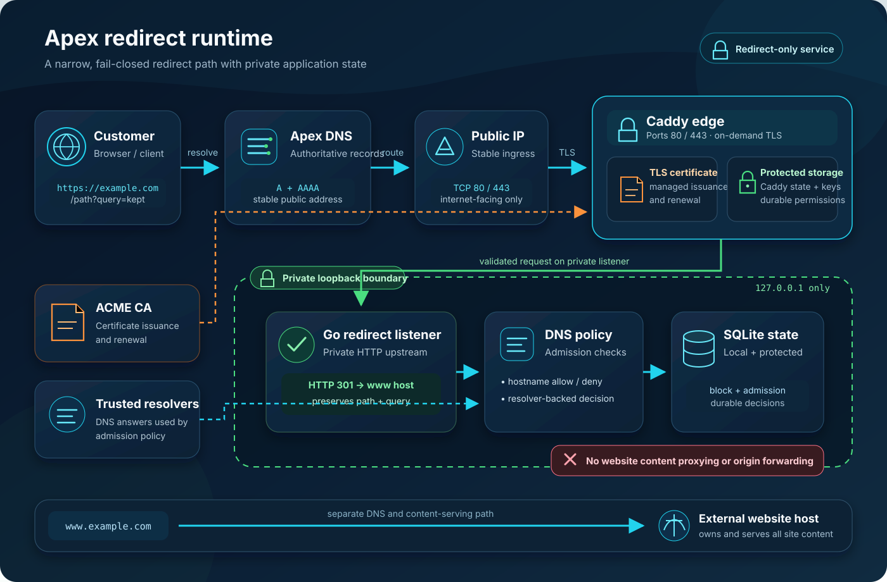
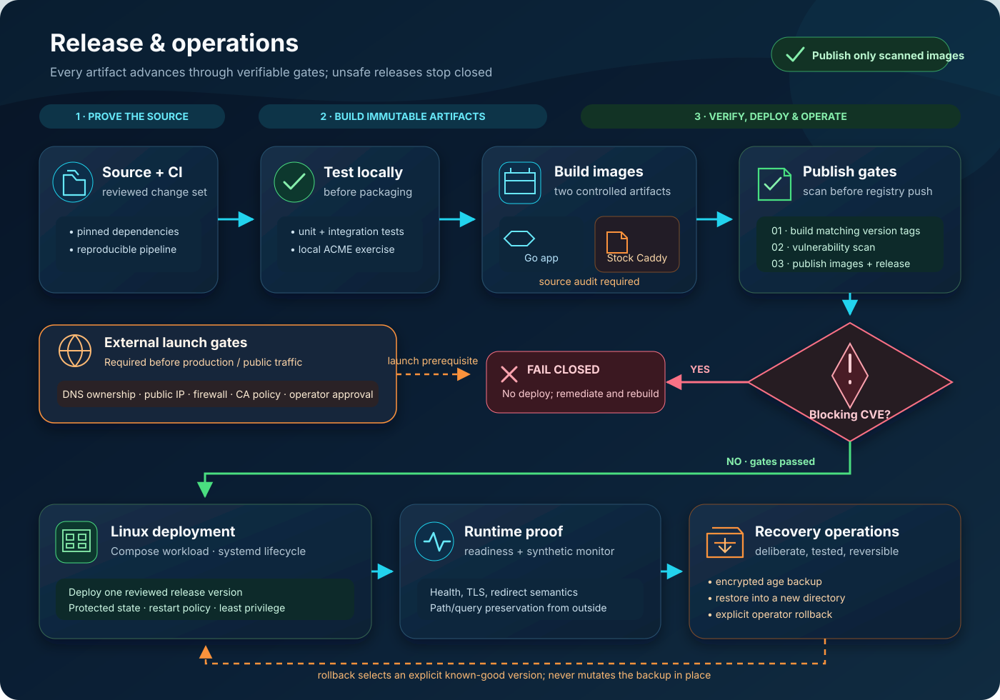

# MC Apex to WWW

Open-source software for operating a self-hosted apex-to-www redirect service.
Operators control their own infrastructure, domains, policies, legal notices,
and acceptable-use decisions. This repository does not provide a hosted service.

The software performs only the redirect, including its apex TLS handling. It
does not manage domain registration or DNS, host websites, or fetch destination
content. There is no dependency on the Websites SaaS platform.

```text
http(s)://example.com/a%2Fb?plan=pro
              -> 301 https://www.example.com/a%2Fb?plan=pro
```

Only GET and HEAD redirect. Other methods return 405. Invalid hosts, DNS policy
failures, operator blocks, and unavailable policy state never produce a redirect.

See [PLAN.md](PLAN.md) for the design and
[PLAN_COMPARISON.md](PLAN_COMPARISON.md) for the comparison with the existing
implementation. The operator-focused
[deployment guide](docs/DEPLOYMENT.md) covers release, monitoring, blocking,
backup, restore, and rollback.

## Deployment at a glance

The recommended beta deployment is one Linux host running two services:

- **Caddy** exposes TCP 80/443, performs ACME and TLS, and forwards only to
  private loopback listeners.
- **Go app** validates DNS and policy, checks durable blocks/admission limits,
  and returns the apex-to-`www` 301 without proxying website content.
- **Persistent storage** keeps SQLite policy state and Caddy certificates,
  keys, and ACME account data in separate protected directories.

Customer apex A/AAAA records point to stable operator addresses; `www` points
directly to the customer's existing website host.

[](docs/assets/runtime-architecture.svg)

MCloudLLC builds and scans both runtime images and publishes matching version
tags to GHCR. Operators select one `RELEASE_VERSION`; Compose pulls and starts
the matching app and Caddy images. Encrypted recovery and explicit rollback
preserve durable state.

## Customer setup

| Record | Name | Value |
| --- | --- | --- |
| A | @ | Operator-published stable IPv4 address |
| AAAA | @ | Operator-published IPv6 address, only when IPv6 is supported |
| CNAME | www | Your existing website host's target |

Replace conflicting apex A/AAAA records; preserve unrelated MX/TXT records.
The apex must resolve directly and exclusively to this instance's approved
service IPs. `www` must resolve to a public destination that is not this service.
Do not enable a DNS provider's HTTP proxy for the apex in the supported setup.

The service accepts registrable domains using the Public Suffix List, including
private suffixes, and normalizes IDNs to ASCII. Arbitrary subdomains, wildcard
enrollment, arbitrary redirect targets, private addresses, and IP-literal hosts
are not supported. Wildcard **blocking** is supported.

DNS changes take time. Configure CAA to permit the intended issuer. A first
HTTPS connection can be delayed or fail while its certificate is obtained.
Fragments are handled by browsers, not received or reconstructed by this server.

## Runtime and configuration

Go handles domain policy, redirects, durable admission state, and private
operator controls. Stock Caddy handles ACME and TLS. Both run on one Linux host;
this is not an HA deployment.

The service uses environment variables, preserving the original repository's
configuration model. [deploy/config.env.example](deploy/config.env.example)
documents non-secret deployment settings; scripts do not load dotenv files.

| Setting | Default / requirement |
| --- | --- |
| `SERVICE_PUBLIC_IPS` | Required comma-separated actual public addresses; documentation/private addresses are rejected |
| `MODE` | `selfhost`; use `public` for open DNS-based enrollment |
| `ALLOWED_DOMAINS` | Required registrable-domain allowlist in selfhost mode; not used in public mode |
| `HTTP_ADDR` | `127.0.0.1:8080`, loopback only |
| `ASK_ADDR` | `127.0.0.1:8081`, loopback only |
| `STATE_PATH` | `/var/lib/apex-redirect/state.db`, absolute path |
| `TRUSTED_PROXIES` | `127.0.0.1/32,::1/128`; never trust arbitrary client forwarding headers |
| `DNS_RESOLVERS` | `1.1.1.1:53,8.8.8.8:53`; both must provide eligible evidence |
| `DNS_TIMEOUT` | `3s` |
| `DNS_CACHE_TTL` / `DNS_NEGATIVE_TTL` | `30s` / `5s`; positive decisions never outlive observed DNS TTLs |
| `MAX_DOMAINS` | `1000` active admission reservations |
| `ADMISSIONS_PER_WINDOW` / `ADMISSION_WINDOW` | `100` new domain reservations per sliding `24h` |
| `ADMISSION_ENABLED` | `true`; disabling denies permission requests, including cold certificate loads |

The SQLite containing directory must have mode 0700, with database/sidecars mode
0600. A missing dedicated directory is created privately; an existing insecure
directory is rejected rather than silently changed. Never place private state
or certificate material in Git.

The private control listener exposes `/ask`, `/healthz`, `/readyz`, and aggregate
Prometheus `/metrics`. There is no public customer-host health-path exemption:
`example.com/healthz` redirects like any other site path. Readiness checks local
policy state, not public DNS, certificate validity, or end-to-end availability.
Monitor a separate owned synthetic domain for those checks.

DNS queries have deadlines, bounded concurrency and caches, CNAME-loop checks,
and per-domain coalescing. A missing address family is distinguished from a
failed lookup. Positive eligibility expires without stale-on-error fallback.
Certificate admission reservations are persistent and transactional across CLI
and daemon processes; they count admissions, not every ACME order or retry.

## Build and validate

Requires Go 1.27.3 or newer compatible tooling; deployment uses Linux and Docker
Compose. The SQLite implementation supports `CGO_ENABLED=0`.

```bash
go test -race ./...
go vet ./...
go mod tidy -diff
CGO_ENABLED=0 go build -trimpath -o apex-redirect .
bash scripts/check.sh
bash scripts/test-acme.sh
```

`check.sh` also requires Docker, Python 3, ShellCheck, and shfmt. The ACME test
uses isolated local fixtures and a local test certificate authority; it does
not issue production certificates or change real DNS. Staging/public
certificate authorities are not a substitute for these offline tests.

To run the Go service directly, explicitly export settings with real service
addresses and an owned allowed domain, choose a protected `STATE_PATH`, then
run `./apex-redirect serve`. It binds only to loopback and expects Caddy to
overwrite `X-Apex-Client-IP` using the actual visitor address.

## Deployment

For the easiest supported VM setup, use a fresh Ubuntu 24.04 LTS host with a
stable public IPv4 address and the Compose deployment. The complete
[step-by-step VM guide](docs/DEPLOYMENT.md#ubuntu-vm-quick-start) covers:

1. VM sizing, firewall rules, and required DNS;
2. Docker Engine, Compose, Python, Git, curl, and age installation;
3. protected persistent storage and a reusable root-owned configuration file;
4. staging deployment, health checks, logs, and end-to-end redirect testing;
5. deliberate production ACME activation; and
6. backup, upgrade, rollback, and routine operations.

The short operator flow, after installing requirements and editing
`/etc/apex-redirect/config.env`, is:

```bash
sudo -i
cd /opt/apex-redirect-www
set -a
. /etc/apex-redirect/config.env
set +a
bash scripts/release.sh
python3 scripts/verify-running.py
curl --fail http://127.0.0.1:8081/readyz
exit
```

Run deployment commands from a root login shell instead of adding an
administrative user to the `docker` group; access to the Docker socket is
effectively root access.

The release workflow builds and scans both images, publishes matching version
tags under `ghcr.io/mcloudllc`, updates `latest`, and creates the GitHub release.
The Caddy image is built from unmodified stock source in
[deploy/Caddy.source.Dockerfile](deploy/Caddy.source.Dockerfile) to avoid stale
base-image and toolchain findings.

[](docs/assets/release-operations.svg)

`CVE-2026-116587` has no published fix for the transitive go-jose/v3 module.
The affected JWK parser is retained by Caddy's local-PKI dependency path, while
this deployment accepts only operator-controlled configuration and uses the
external ACME issuer. The exact package exception is visible in
`.trivyignore.yaml`, expires automatically, and must be removed when upstream
publishes a fix. It is not a blanket unfixed-vulnerability exemption.

The Linux host-network [Compose definition](deploy/compose.yaml) keeps Go and
Caddy administration private while exposing TCP 80/443 through Caddy. HTTP/1.1
and HTTP/2 are enabled; HTTP/3 is intentionally deferred. Only advertise IPv6
after testing the VM, both firewalls, DNS, ACME validation, and external traffic.
Both services rotate Docker JSON logs at 10 MB per file, keeping three files;
this is a disk-space bound, not a complete time-based privacy retention policy.

Provision protected persistent directories using the ownership shown in the
configuration example. Set `RELEASE_VERSION` to a published version and export
the remaining settings, then:

```bash
bash scripts/release.sh
curl --fail http://127.0.0.1:8081/readyz
```

Examples default to Let's Encrypt staging, whose certificates are not trusted
by browsers. A production issuer requires explicit `PRODUCTION_ACME_APPROVED=yes`.
`MODE=public` is an operator choice that permits DNS-based enrollment by
domains pointing at that operator's service. Operators are responsible for
capacity, abuse handling, legal review, monitoring, and public communications.

For native deployment, retain [deploy/apex-redirect.service](deploy/apex-redirect.service)
and install the reviewed [deploy/caddy.service](deploy/caddy.service) with
[deploy/Caddyfile](deploy/Caddyfile). Install verified binaries, create the
`apex-redirect` and `caddy` system users, and provision a root-controlled
`/etc/default/apex-redirect` containing the non-secret runtime settings.
Install the Go binary as `/usr/local/bin/apex-redirect` and Caddy as
`/usr/bin/caddy`. StateDirectory settings create protected state directories.
Do not replace an existing operator-managed systemd unit without reviewing it.

## Blocking and certificate retirement

Run operator commands as the service user against the same `STATE_PATH`:

```bash
apex-redirect block add --kind domain --value example.com --reason "Abuse report" --operator operations
apex-redirect block add --kind wildcard --value '*.example.com' --reason "Domain family abuse" --operator operations
apex-redirect block add --kind ip --value 192.0.2.1 --reason "Abusive client" --operator operations --expires 24h
apex-redirect block add --kind cidr --value 2001:db8::/32 --reason "Abusive network" --operator operations
apex-redirect block list
apex-redirect block remove --id 1
apex-redirect admissions list
apex-redirect admissions forget --domain example.com
```

The IP examples above are documentation-only addresses for policy examples,
not valid service addresses. For Compose, use
`docker compose --env-file /dev/null -f deploy/compose.yaml exec -T app /apex-redirect`
in place of `apex-redirect`.

Exact and wildcard rules check both apex and generated `www` destination.
`*.example.com` therefore blocks an apex redirect to `www.example.com`, without
matching `notexample.com`. Client-IP/CIDR matching uses Caddy's overwritten peer
metadata, not a visitor-supplied forwarding header. IP blocks deny HTTP service;
use host/provider network controls when a pre-TLS connection ban is required.

Block changes take effect on subsequent redirect requests even with cached
DNS or TLS state. **A Caddy reload does not retire already managed certificates.**
Use `bash scripts/retire-domain.sh DOMAIN REASON OPERATOR` for an exact domain;
it persists the block, verifies denial, fully restarts Caddy, and verifies TLS
handshake denial without deleting stored certificates. For wildcard blocks,
persist the rule and fully restart Caddy, verifying affected enrolled domains.
The native workflow uses `RUNTIME=systemd`. A full restart briefly interrupts
the shared TLS edge; this deployment has no HA standby.

Forgetting an admission frees an active reservation but does not erase
in-window rate-budget history, install a block, or remove certificates. Never
use it as a substitute for domain retirement. Neither blocks nor retirement
can recall a 301 already cached in a browser.

## Backups and rollback

Keep both SQLite state and Caddy certificate/account storage persistent across
updates. Use the reviewed `scripts/snapshot.sh` backup/offline-restore workflow
with encrypted archives, protected key handling, checksums, and a restore
rehearsal before relying on backups. Follow the helper's required encryption
configuration; never store raw certificate keys in an unencrypted backup.
The online backup helper requires both expected services already running and
refuses a stopped release without starting it.

Backup requires `AGE_RECIPIENT`, an offline backup public recipient. Restore
requires `AGE_IDENTITY_FILE`, a protected private identity file path, not its
contents in an environment variable or command argument. With those settings
and reviewed deployment settings exported:

```bash
bash scripts/snapshot.sh backup /secure/backups/release.tar.age
bash scripts/rollback.sh /secure/backups/release.tar.age /srv/apex-restored-new
```

Keep the encrypted archive and its `.sha256` sidecar together. Restore verifies
the ciphertext checksum, decrypts and validates member paths before extraction,
and rejects plaintext, links, special files, and overwriting an existing target.

Restore into a new directory only. `scripts/rollback.sh` prepares an offline
restore; it does not automatically redeploy or delete current data. Review
archived manifests, release versions, scan evidence and ownership, stop
writers, then explicitly select/start an accepted release. Never delete
durable volumes or run `docker compose down -v`.

## Operator responsibility

The code is licensed under [Apache-2.0](LICENSE) and provided without warranty.
Each operator is responsible for infrastructure, security updates, DNS and
certificate-authority compliance, monitoring, backups, incident response,
capacity, abuse handling, and applicable legal or privacy obligations.
[TERMS.md](TERMS.md) and [PRIVACY.md](PRIVACY.md) are optional starting
templates for operators; they are not legal advice or project-wide policies.
